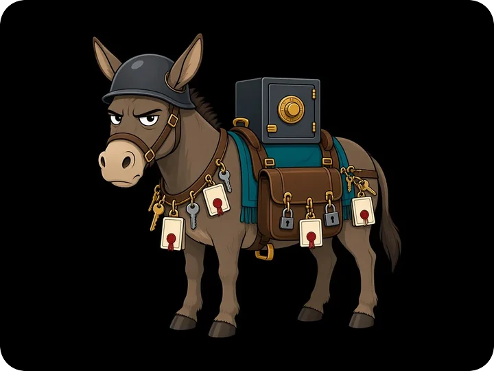
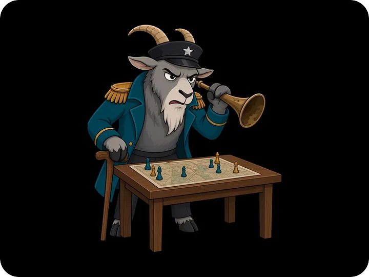
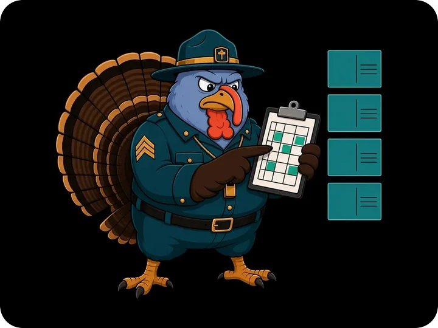

<a href="https://blowhorn.ai">
  <picture>
    <source media="(prefers-color-scheme: dark)" srcset="assets/hero-dark.webp">
    
  </picture>
</a>

<h3>Write it once. Every profile you run says it, as you.</h3>

Blowhorn is a private Mac app for marketers, founders, devrel, agencies and remote teams. 
It posts, amplifies and runs LinkedIn outreach across the social profiles you control, 
typing and clicking in your own Chrome, on your own computer.

<a href="https://blowhorn.ai/download"><picture><source media="(prefers-color-scheme: dark)" srcset="assets/button-download-dark.png"></picture></a>&nbsp;&nbsp;
<a href="https://blowhorn.ai"><picture><source media="(prefers-color-scheme: dark)" srcset="assets/button-site-dark.png"></picture></a>

Already works with <b>LinkedIn</b> · <b>X</b> · <b>Reddit</b> · <b>Hacker News</b> · <b>Bluesky</b> · <b>Slack</b> · <b>GitHub</b>, with more platforms on the way

 

## Why people fall in behind Major

<table>
<tr>
<td width="42%"></td>
<td>

### Tab after tab after tab. Somebody call a medic.

You paste the same announcement into LinkedIn, then X, then Reddit, then your second LinkedIn, then your company page, then you lose track. Blowhorn gives you **one queue for every profile you run**. Write it once, pick where it goes, and Blowhorn posts it as you, right on time. Your browser goes back to being a browser.

<b>Trench Trooper</b>, dug in against tab chaos since day one.

</td>
</tr>
<tr>
<td>

### Your launch post deserves more than crickets.

A post lives or dies in its first hour. Schedule one message and **every profile you add amplifies it at the moment you pick**: reposts, quotes and comments from real accounts, each one posting as itself. Teammates add their own profiles once and join every wave after that. No more "hey, can everyone like this?" in Slack.

<b>Recruit Chick</b>. Small. Loud. First to fire.

</td>
<td width="42%"></td>
</tr>
<tr>
<td width="42%"></td>
<td>

### Other tools want your password. Blowhorn doesn't.

Most outreach tools log in as you from their own servers, with your password, your 2FA codes or your cookies sitting in someone else's cloud. Blowhorn **does the typing and clicking in your own Chrome, on your own computer**, signed in as you. No Blowhorn server ever logs in as you.

<b>Sleeper Cell</b>. Not sleepy. Just quiet. Very, very quiet.

</td>
</tr>
<tr>
<td>

### No meter running. Your app, your computers.

Blowhorn never charges per post, so you don't ration reposts or count credits. Install it on **your computers** and they work as one: they share one queue, they're coordinated so the same post isn't sent from two of them, and whichever one is awake picks up the next job.

<b>Platoon Private</b>. Packs the posts. Brings the backup.

</td>
<td width="42%"></td>
</tr>
</table>

 

## A taste of the menu

Posting is just the opening act. Here is a sampling of what Blowhorn already does across your profiles, and the list keeps growing:

  <picture>
    <source media="(prefers-color-scheme: dark)" srcset="assets/activities-dark.webp">
    
  </picture>

 

## Built for teams, agencies and their clients

<table>
<tr>
<td width="33%" valign="top">

### Coordinate centrally. Act from your own computer.

Remote team? Everyone shares one plan and one queue, and each teammate posts from **their own computer**, signed in as themselves. Their sign-ins and profiles stay in their own hands.

<b>The G.I.</b> Carries your secrets. Tells no one.

</td>
<td width="33%" valign="top">

### Your agency's brand, not ours.

Big agency? Put **your logo and colors** on the interfaces, reports and emails your clients see. They see your agency, never Blowhorn.

<b>The General</b>. Grouchy. Reads every report anyway.

</td>
<td width="33%" valign="top">

### A workspace for every client.

Keep each client in **its own workspace**, with its own profiles and schedules. Nothing crosses wires, and the right people work together on the right account.

<b>Chief Drill Instructor</b>. Furious about mess.

</td>
</tr>
</table>

Team invites are coming soon. Today, teammates install Blowhorn, sign in to your account and add their own profiles.

 

## What stays yours

- **Your sign-ins.** LinkedIn, X, Reddit and Hacker News run in your own Chrome, where your sessions already live. Each Blowhorn profile gets its own Chrome profile, so your everyday browsing stays exactly as you left it.
- **Your computers do the work.** Every post, reply and repost runs on one of your computers. Your Blowhorn account only keeps them in sync.
- **Your voice, unbranded.** Blowhorn never brands or tags what you post. It looks like you because it is you.
- **Your hand on the lever.** Pause one action, one computer or all of them, then pick up where you left off. CAPTCHAs and 2FA prompts always come to you.
- **A careful pace.** Blowhorn types key by key and keeps to built-in daily caps, the way a careful person would.

[Where your data lives &rarr;](https://blowhorn.ai/docs/explanation/your-data/)

 

<a href="https://blowhorn.ai/download">
  <picture>
    <source media="(prefers-color-scheme: dark)" srcset="assets/cta-dark.webp">
    
  </picture>
</a>

  

<a href="https://blowhorn.ai/download"><picture><source media="(prefers-color-scheme: dark)" srcset="assets/button-download-dark.png"></picture></a>&nbsp;&nbsp;
<a href="https://blowhorn.ai"><picture><source media="(prefers-color-scheme: dark)" srcset="assets/button-site-dark.png"></picture></a>

<a href="https://blowhorn.ai/major/">Meet Major and the army</a> · <a href="https://blowhorn.ai/docs/">Docs</a> · <a href="https://blowhorn.ai/docs/reference/support/">Get help</a> · <a href="https://blowhorn.ai/legal/">Trust Center</a>

  

&copy; 2026 Layer5, Inc. All product names and logos are trademarks of their respective owners. Blowhorn is not affiliated with or endorsed by any of them.

