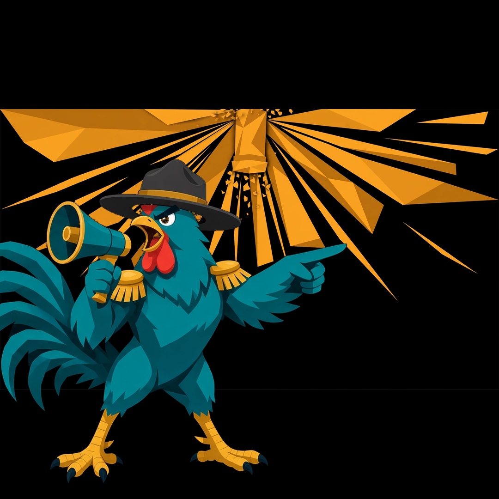
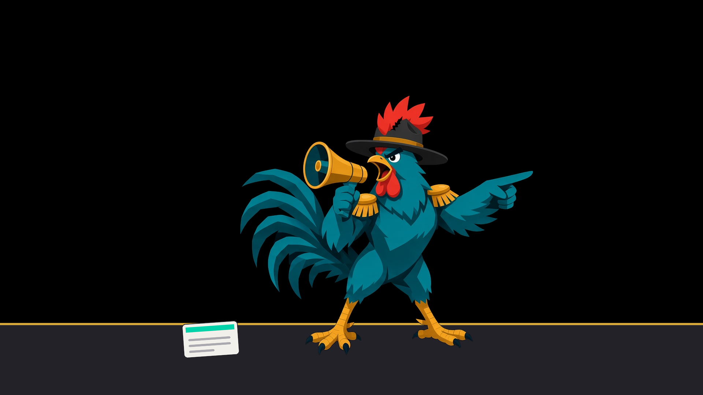
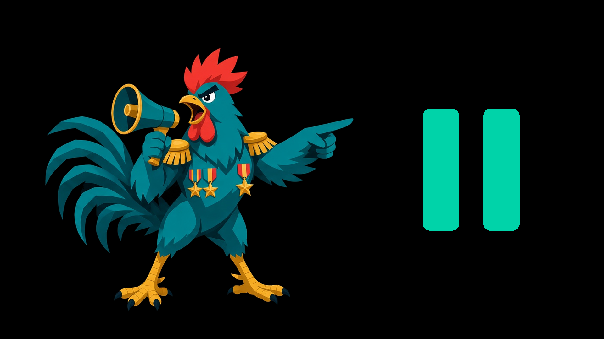

# 📣 Blowhorn

### Your voice, everywhere. On schedule.

Blowhorn is the Mac app that plans, drafts, and posts your content for you,
so the right post goes out at the right time, even when you are doing anything else.

---

## Get Blowhorn now

**The fastest way in is the download.** Grab the Mac app, run through a
five-minute setup, and your first scheduled post can be live today.

| | |
|---|---|
| 🍎 **Download for Mac** | **[Get the latest release](https://github.com/blowhorn-ai/blowhorn-site/releases)** - the Mac app (DMG) lives on the releases page |
| 🌐 **See it first** | **[blowhorn.ai](https://blowhorn.ai)** - what Blowhorn does, in plain words |
| 📖 **Learn it properly** | **[blowhorn.ai/docs](https://blowhorn.ai/docs)** - guides, how-tos, and reference |

No account juggling, no spreadsheet of posting times, no "I meant to post
that." Download it, set it up once, and let the schedule carry the work.

---

## What Blowhorn does

- **Schedule once, post on time.** Queue posts, drafts, and recurring
  activity, and Blowhorn sends them when they are due.
- **Work from a menu bar, not a browser tab.** A small popover shows what
  is due, what is running, and what needs you. The full console is there
  when you want it, and out of the way when you do not.
- **Keep your browsing yours.** Blowhorn works in a Chrome profile set
  aside for it, so your everyday windows, tabs, and sign-ins stay exactly
  as you left them.
- **Post with guardrails.** Risk Profiles and Safety controls let you
  decide how bold or careful each post should be, with limits that hold
  even when you are in a hurry.
- **Stay in charge of the queue.** Pause everything with one click,
  review drafts before they go out, and see what posted and what is next.

## Where it posts

Blowhorn works across the places you already publish, including:

`LinkedIn` `X` `Reddit` `Hacker News` `Slack` `Bluesky` `GitHub`

## How it works

1. **Download and install** the Mac app from the releases page.
2. **Connect your accounts** in a dedicated Chrome profile during the
   guided setup. It takes about five minutes.
3. **Draft or schedule** your content, pick how careful it should be,
   and let Blowhorn post it on time. Pause anytime, from the menu bar.

---

## Scenes from the Army

Major Blowhorn leads the Army, and the Army has a scene for every part of
the job. These six are covered scenes from the Major Blowhorn scene
catalog, drawn with the locked Major art: the hero, the signal, the
battle, the pause, the posted toast, and the banner.

| | |
|---|---|
|  |  |
| **MU-01 - Home Hero: Major Commands.** Major takes command of the day's posts. | **RC-03 - Signal Flare.** The signal goes up, and the Army moves. |
|  |  |
| **BT-23 - Last Stand at the Empty Feed.** Never let the feed go quiet. | **PF-10 - Pause and Resume.** Pause everything with one click, resume when ready. |
|  |  |
| **MU-11 - Success Toast: Posted.** Posted. The toast says it all. | **MU-22 - LinkedIn Banner.** Built for the feed where your work lives. |

The full catalog holds 195 scenes across battles, drills, recon and
comms, platforms, product features, emotional beats, seasonal moments,
and marketing uses. These six are the ones that tell the story fastest:
command, signal, battle, pause, posted, banner.

---

## Inside this organization

| Repository | What lives there |
|---|---|
| [blowhorn-site](https://github.com/blowhorn-ai/blowhorn-site) | The public website, docs source, and Mac releases (DMGs) |
| Blowhorn | The app itself: desktop app, scheduler, and command line tool |
| .github | This profile, plus organization community health files |

---

### You have something to say. Blowhorn makes sure it gets said, on time.

**[⬇ Download Blowhorn for Mac](https://github.com/blowhorn-ai/blowhorn-site/releases)**

Questions? Start with the [docs](https://blowhorn.ai/docs), or visit
[blowhorn.ai](https://blowhorn.ai).

