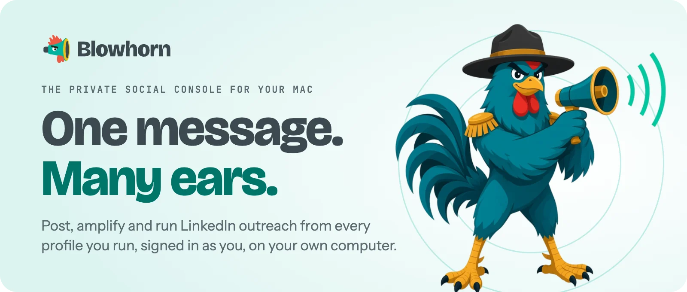
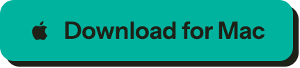
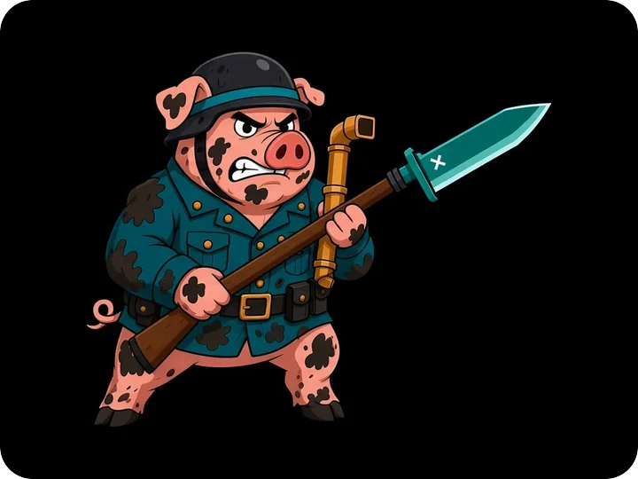
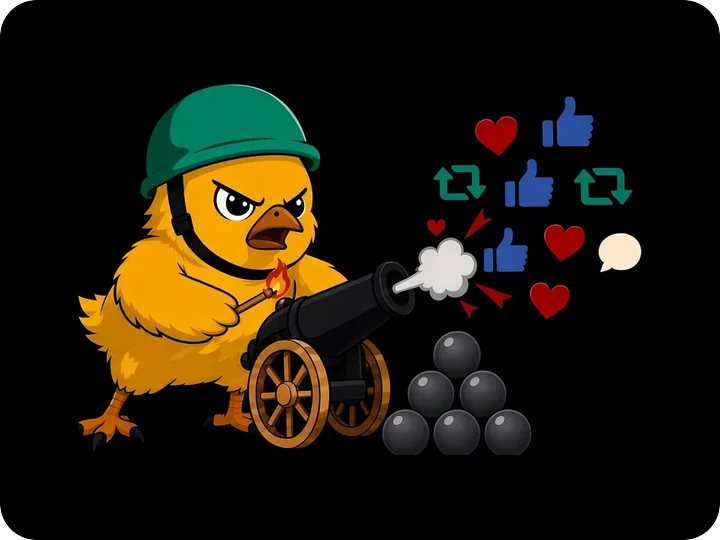
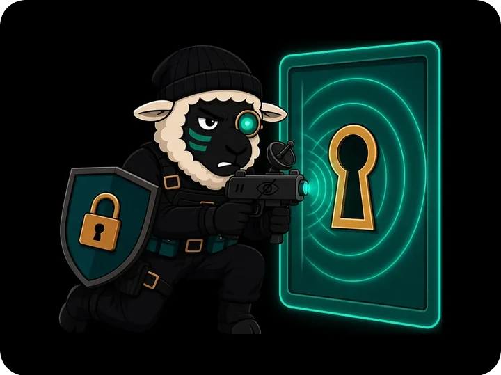
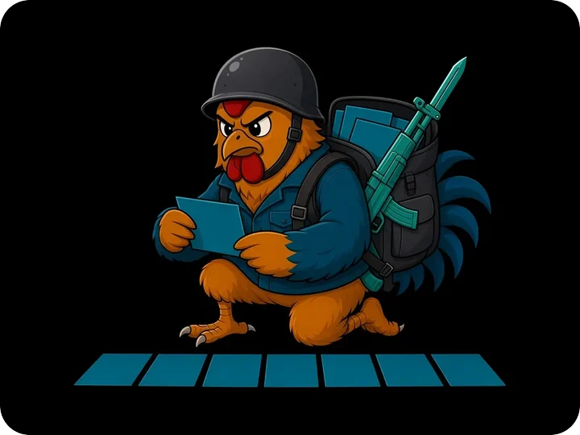
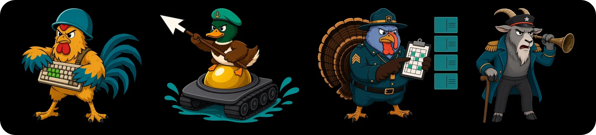
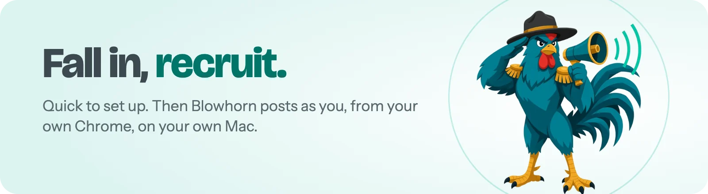

<a href="https://blowhorn.ai">
  <picture>
    <source media="(prefers-color-scheme: dark)" srcset="assets/hero-dark.webp">
    
  </picture>
</a>

<h3>Write it once. Every profile you run says it, as you.</h3>

Blowhorn is a private Mac app for marketers, founders, devrel and small teams. 
It posts, amplifies and runs LinkedIn outreach across the social profiles you control, 
typing and clicking in your own Chrome, on your own computer.

<a href="https://blowhorn.ai/download"><picture><source media="(prefers-color-scheme: dark)" srcset="assets/button-download-dark.png"></picture></a>&nbsp;&nbsp;
<a href="https://blowhorn.ai"><picture><source media="(prefers-color-scheme: dark)" srcset="assets/button-site-dark.png"></picture></a>

Works with <b>LinkedIn</b> · <b>X</b> · <b>Reddit</b> · <b>Hacker News</b> · <b>Bluesky</b> · <b>Slack</b> · <b>GitHub</b> reactions &nbsp;|&nbsp; macOS 13 or later &nbsp;|&nbsp; about a minute to set up

 

## Why people fall in behind Major

<table>
<tr>
<td width="42%"></td>
<td>

### Seven tabs. One post. Somebody call a medic.

You paste the same announcement into LinkedIn, then X, then Reddit, then your second LinkedIn, then your company page. Blowhorn gives you **one queue for every profile you run**. Write it once, pick where it goes, and Blowhorn posts it as you, right on time. Your browser goes back to being a browser.

<b>Trench Trooper</b>, dug in against tab chaos since day one.

</td>
</tr>
<tr>
<td>

### Your launch post deserves more than nine likes.

A post lives or dies in its first hour. Schedule one message and **every profile you add amplifies it at the moment you pick**: reposts, quotes and comments from real accounts, each one posting as itself. Teammates add their own profiles once and join every wave after that. No more "hey, can everyone like this?" in Slack.

<b>Recruit Chick</b>. Small. Loud. Armed with likes.

</td>
<td width="42%"></td>
</tr>
<tr>
<td width="42%"></td>
<td>

### Other tools want your password. Blowhorn doesn't.

Most outreach tools log in as you from their own servers, with your password, your 2FA codes or your cookies sitting in someone else's cloud. Blowhorn **does the typing and clicking in your own Chrome, on your own computer**, signed in as you. No Blowhorn server ever logs in as you.

<b>Sleeper Cell</b>. Not sleepy. Just quiet. Very, very quiet.

</td>
</tr>
<tr>
<td>

### All you can eat, on an app you control.

No seat math and no per-post meter. Install Blowhorn on **every computer you own**: they share one queue, they're coordinated so the same post isn't sent from two of them, and whichever computer is awake picks up the next job. Run as many profiles as you like.

<b>Platoon Private</b>. Packs the posts. Brings the backup.

</td>
<td width="42%"></td>
</tr>
</table>

 

## Meet the troops

Major Blowhorn leads, and only Major carries the bullhorn. His troops handle the rest:

  

**Keyboard Warrior** writes the post once and carries it everywhere your people are. **Mouse Marine** clicks the real buttons in your own Chrome, and salutes and hands you any CAPTCHA. The **Chief Drill Instructor** lines up your week and blows the whistle when each post is due. And **the General** reads the results: real likes, replies and follows. He is hard of hearing, so the bugle stays at his ear.

[Meet Major and the whole army &rarr;](https://blowhorn.ai/major/)

 

## What stays yours

- **Your sign-ins.** LinkedIn, X, Reddit and Hacker News run in your own Chrome, where your sessions already live. Each Blowhorn profile gets its own Chrome profile, so your everyday browsing stays exactly as you left it.
- **Your computers do the work.** Every post, reply and repost runs on one of your computers. Your Blowhorn account only keeps them in sync.
- **Your voice, unbranded.** Blowhorn never brands or tags what you post. It looks like you because it is you.
- **Your hand on the lever.** Pause one action, one computer or all of them, then pick up where you left off. CAPTCHAs and 2FA prompts always come to you.
- **A careful pace.** Blowhorn types key by key and keeps to built-in daily caps, the way a careful person would.

[Where your data lives &rarr;](https://blowhorn.ai/docs/explanation/your-data/)

 

<a href="https://blowhorn.ai/download">
  <picture>
    <source media="(prefers-color-scheme: dark)" srcset="assets/cta-dark.webp">
    
  </picture>
</a>

  

<a href="https://blowhorn.ai/download"><picture><source media="(prefers-color-scheme: dark)" srcset="assets/button-download-dark.png"></picture></a>&nbsp;&nbsp;
<a href="https://blowhorn.ai"><picture><source media="(prefers-color-scheme: dark)" srcset="assets/button-site-dark.png"></picture></a>

<a href="https://blowhorn.ai/docs/">Docs</a> · <a href="https://blowhorn.ai/docs/reference/support/">Get help</a> · <a href="https://blowhorn.ai/legal/">Trust Center</a>

  

&copy; 2026 Layer5, Inc. LinkedIn, X, Reddit, Hacker News, Slack, Bluesky and GitHub are trademarks of their respective owners. Blowhorn is not affiliated with or endorsed by any of them.

